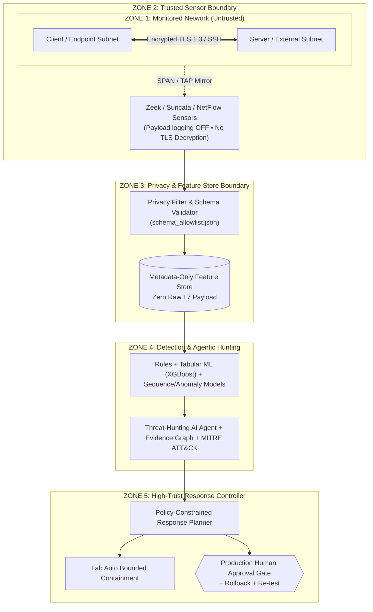

# Topic 04: Agentic ML/DL for Metadata-Only TLS/SSH Threat Detection, Hunting & Response

Course: **NT219 / NT2205 — Cryptography and Applications**

## 1. Core Principles & Non-Negotiables
- **No Raw Layer-7 Application Payload (`SR-01`, `CR-06`)**: Strictly operates on L3/L4 flow metadata and L5/L6 cryptographic/session handshake metadata (TLS 1.3, X.509, SSH). Enforced via [`data/schemas/schema_allowlist.json`](data/schemas/schema_allowlist.json).
- **End-to-End Reasoning Chain**:
  $$\text{System Analysis} \rightarrow \text{Assets} \rightarrow \text{Threat Model} \rightarrow \text{Security Requirements} \rightarrow \text{Security Architecture} \rightarrow \text{Cryptographic Requirements} \rightarrow \text{Mechanisms} \rightarrow \text{Implementation} \rightarrow \text{Security Testing} \rightarrow \text{Evaluation}$$

---

## 2. System & Trust Boundary Architecture

Chi tiết phân tích kiến trúc và bảng giả định tin cậy xem tại: [`report/system_trust_architecture.md`](report/system_trust_architecture.md).



---

## 3. Repository Structure
```text
topic04-agentic-tls-ssh-threat-detection/
├── data/
│   ├── public_loaders/       # NF-UQ, IoT-23, CESNET, CTU...
│   ├── lab_metadata/         # JSON/Parquet only; no L7 raw payload
│   ├── manifests/            # scenario ground truth
│   └── schemas/              # schema_allowlist.json + privacy validator
├── sensors/                  # Zeek/Suricata metadata configs
├── src/
│   ├── features/             # metadata extraction & fingerprinting (JA4/HASSH)
│   ├── models/               # tabular/anomaly/sequence/graph
│   ├── hunting/              # evidence graph + ATT&CK retrieval
│   ├── agent/                # policy guard, planner, verifier
│   └── response/             # simulator + bounded lab adapters
├── experiments/              # configs, splits, ablations, logs
├── tests/                    # privacy, policy, model, response tests
├── docker/                   # container setups
└── report/                   # system_trust_architecture.md & reports
```
