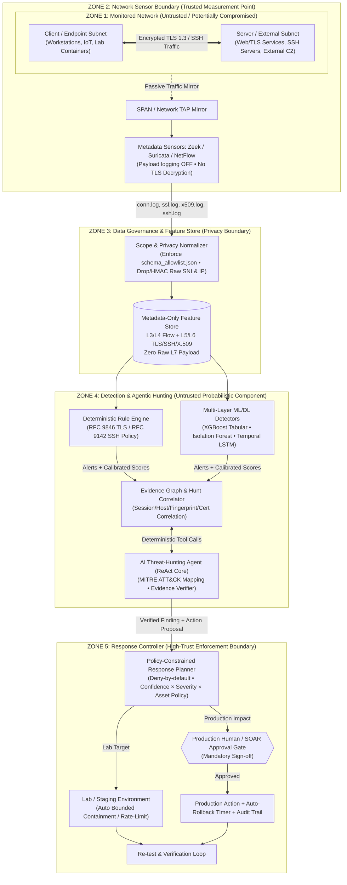
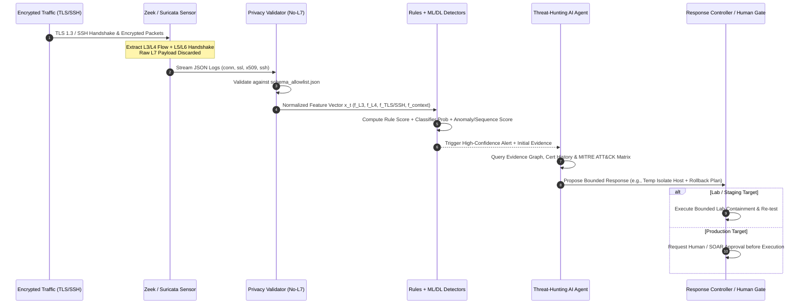

# Phase 1 & Phase 5 — System, Trust Boundary & Security Architecture

Tài liệu này định nghĩa **Sơ đồ Kiến trúc Hệ thống (System Architecture)** và **Ranh giới Tin cậy (Trust Boundaries)** cho **Topic 04: Agentic ML/DL for Metadata-Only TLS/SSH Threat Detection, Hunting & Response**, tuân thủ nghiêm ngặt quy định **No Raw Layer-7 Payload** (SR-01, CR-06).

---

## 1. System & Trust Boundary Diagram (Phase 1)

Sơ đồ dưới đây phân tách rõ 6 vùng tin cậy (Trust Zones): từ vùng mạng chưa tin cậy (Client/Server Subnet), qua điểm đo tin cậy (Sensor), kho đặc trưng đã lọc L7 (Feature Store), vùng mô hình xác suất (ML/DL & Agent) đến bộ điều khiển phản hồi tin cậy cao (Response Controller & Human Approval Gate).

---

## 2. Bảng Phân tích Ranh giới Tin cậy (Trust Assumptions Matrix)

| Vùng / Thành phần (Zone / Component) | Giả định Tin cậy (Trust Assumption) | Dữ liệu Quan sát & Ràng buộc An toàn (Required Observation & Safety Rule) |
| :--- | :--- | :--- |
| **1. Client / Endpoint Subnet** | **Untrusted:** Có thể chứa máy bị nhiễm mã độc (C2 beaconing) hoặc cấu hình sai. | Định danh ẩn danh (`src_host_token`), thống kê luồng, hành vi TLS/SSH fingerprint (`ja4`, `hassh`). |
| **2. Server / Service Subnet** | **Untrusted / Semi-trusted:** Dịch vụ có thể bị tấn công brute-force hoặc chứng chỉ bị thay đổi. | Port/Service, tóm tắt chứng chỉ X.509 (`cert_spki_token`), phiên bản giao thức, Cipher/KEX policy. |
| **3. Network Sensor (Zeek/Suricata)** | **Trusted Measurement Point:** Điểm thu thập độc lập, không lưu payload. | Chỉ xuất metadata L3–L6; tắt hoàn toàn packet/payload dumping; giám sát sensor health. |
| **4. Privacy Filter & Feature Store** | **Privacy Enforcement Boundary:** Chứa telemetry an ninh, tuyệt đối không chứa nội dung ứng dụng. | Kiểm duyệt bằng [schema_allowlist.json](../data/schemas/schema_allowlist.json), băm/ẩn danh SNI và IP nội bộ. |
| **5. ML/DL Models & Hunting Agent** | **Untrusted Probabilistic Component:** Mô hình có thể dự đoán sai hoặc bị hallucination. | Mọi kết luận phải gắn với bằng chứng (Evidence-grounded); không được tự ý thực thi lệnh chặn trực tiếp. |
| **6. Response Controller & Human Gate** | **High-Trust Component:** Điểm thực thi chính sách an toàn cuối cùng. | Chỉ cho phép các hành động trong allowlist; giới hạn thời gian (TTL/Rollback); bắt buộc **Human Approval** đối với production. |

---

## 3. Luồng Xử lý Multi-Layer Feature Fusion & Agentic Response (Phase 5)

